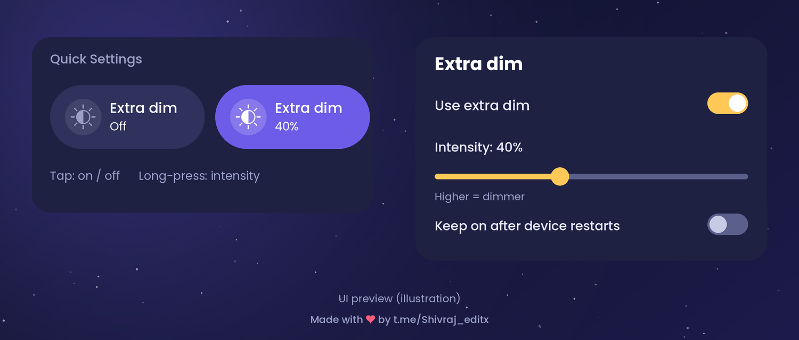
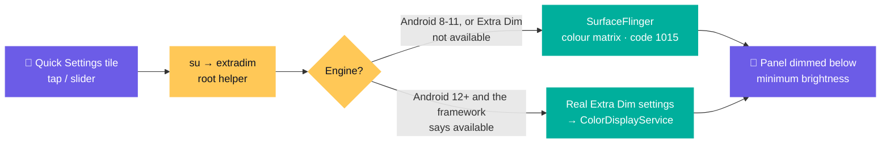

<div align="center">


<br>

[](https://github.com/shivrajtode/ExtraDim-Magisk/releases/latest)
[](#-compatibility)
[](#-install)
[](LICENSE)
[](https://t.me/Shivraj_editx)

### 🌙 The real Extra Dim for ROMs that don't have it

Stock and custom ROMs that skipped Android 12's *Extra dim* (or never exposed it) get it back:<br>
a proper **colour-matrix dim, not an overlay**, a **Quick Settings tile**, an **intensity slider**<br>
and **no root grant to fiddle with**.

</div>

---

## ✨ Highlights

| | |
|---|---|
| 🎨 **Real dimming, not an overlay** | The same compositor-level colour matrix AOSP uses for Extra Dim and Night Light. No "draw over apps", no screen-overlay warnings. |
| 🧩 **Tile + slider** | Tap to toggle, long-press for intensity (0–100) and *Keep on after restart*. |
| 🔋 **Battery-aware** | `extradim check` tells you whether the dim stays on the display controller or falls back to the GPU. No polling: the only thing left running is one idle listener that wakes when you tap the tile. |
| 🔑 **No root grant needed** | Magisk gets the grant automatically. On **KernelSU and APatch** (which hide system apps in their root list and have no command to grant root) the tile talks to the module's idle listener instead, so there is nothing to unhide or allow. |
| ♻️ **Restart = back to normal** | After any restart the dim is gone and the tile reads Off, unless you enable *Keep on after restart* (same as AOSP). |
| 🧠 **Picks the right engine** | Android 12+ ROMs that really have Extra Dim get the native one; everything else gets the SurfaceFlinger engine. |
| 🛡️ **Systemless** | Nothing in framework or SystemUI is patched. The tile is a plain app shipped as a systemless system app. |

<div align="center">

</div>

## 📲 Install

1. Download **`ExtraDim-<version>.zip`** from [Releases](https://github.com/shivrajtode/ExtraDim-Magisk/releases/latest).
2. **Magisk / KernelSU / APatch → Modules → Install from storage**, pick the zip, reboot.
3. After boot the **Extra dim** tile is added to Quick Settings (first boot only). Tap it. That's it: no root prompt, nothing to enable under *show system apps*.

> [!TIP]
> Don't want the idle listener? `touch /data/adb/extradim/no-listener` and reboot. The tile then falls back to `su`, which needs a root grant (automatic on Magisk, manual on KernelSU/APatch).

> [!NOTE]
> Already installed the tile app by hand? It keeps working (same package and signature). For a clean module-owned copy run `su -c 'pm uninstall com.extradim.tile'` and reboot.

## 🧪 Verify in 30 seconds

```sh
su -c 'extradim test'     # dims for 3 s, then restores itself
su -c 'extradim check'    # battery check: display controller or GPU?
su -c 'extradim status'   # engine, state, Android API
su -c 'extradim diag'     # full report to paste into an issue
```

If `test` doesn't dim the screen, please [open an issue](https://github.com/shivrajtode/ExtraDim-Magisk/issues/new?template=bug_report.md) with the output of `su -c 'extradim diag probe'`.

## 🎚️ Use

| Command | What it does |
|---|---|
| `extradim on [0-100]` | Turn on, optionally set intensity (higher = dimmer) |
| `extradim off` / `toggle` | Turn off / flip |
| `extradim level N` | Change intensity, applied live if on |
| `extradim persist 0\|1` | Keep on after restart (default **0**) |
| `extradim status` | State, engine, API |
| `extradim test` / `check` | 3-second test / battery check |
| `extradim engine sf\|auto` | Force the SurfaceFlinger engine, or let it choose |
| `extradim diag [probe]` | Diagnostic report (add `probe` for a 1-second raw SurfaceFlinger test) |

Everything is also on the tile: **tap** = on/off, **long-press** = intensity slider + *Keep on after restart*.

## 📱 Compatibility

| Android | API | Engine | Status |
|---|---|---|---|
| 8.0 – 8.1 | 26–27 | SurfaceFlinger | 🧪 expected to work |
| 9 | 28 | SurfaceFlinger | 🧪 expected to work |
| 10 – 11 | 29–30 | SurfaceFlinger | ✅ verified on Android 11 |
| 12 – 17+ | 31+ | **Native** when the framework reports Extra Dim as available, otherwise SurfaceFlinger | 🧪 expected to work |

> [!NOTE]
> 🧪 means the logic is covered by automated simulation of each Android version but not yet confirmed on real hardware. Reports (working or not) are very welcome.

**Android 12+ ROMs where Extra Dim is "not available":** the module never writes AOSP's `reduce_bright_colors_*` settings there (the framework hasn't set its colour transform up, so doing so could blank the screen). It uses the SurfaceFlinger engine and its own settings keys instead. The tile app must be **v1.1 or newer** for that; the zip published by `tools/publish.sh` already contains it, and when building from source run `bash tools/build.sh --app` once.

## 🔍 How it works



Android's own Extra Dim ends in one call: a colour matrix pushed to SurfaceFlinger. The SurfaceFlinger engine makes that same call from a root helper, so the result is the real thing without patching the framework. Details, sources and the numbers behind the intensity curve are in **[docs/HOW-IT-WORKS.md](docs/HOW-IT-WORKS.md)**.

## ⚠️ Limitations

> [!WARNING]
> - **SurfaceFlinger engine:** Night Light, colour inversion and colour correction share the same matrix slot. Changing one replaces the dim until you toggle Extra Dim off and on. (The native engine on Android 12+ composes them properly.)
> - Auto-brightness is not re-tuned for the dim (native Android 12+ does that).
> - If `extradim check` says **WARNING**, your panel pipeline dims on the GPU: extra power, and DRM video may go black. AOSP hides Extra Dim on such devices for the same reason.
> - The no-grant path needs `inotifyd` or `mkfifo` (toybox or the manager's busybox); if neither works the tile falls back to `su`.
> - The SurfaceFlinger engine writes its matrix from outside the system, so a ROM feature that re-sends its own matrices (Display White Balance, Night Light) can replace it.
> - Verified on Android 11 with Magisk only so far (see the table above).

## ❓ FAQ

<details>
<summary><b>It says on, but the screen doesn't dim</b></summary>

Run `su -c 'extradim diag probe'` and look at the `engine` line. If the native engine is in use on an Android 12+ ROM, the helper already switches to the SurfaceFlinger engine when the framework doesn't activate Extra Dim. You can also force it: `su -c 'extradim engine sf'`, then tap the tile again. If it still doesn't dim, paste the `diag probe` output in an issue.
</details>

<details>
<summary><b>Is this an overlay?</b></summary>

No. Nothing is drawn over your apps. The screen output is scaled by a colour matrix in the compositor, exactly like Night Light does, so there are no "screen overlay detected" dialogs and no extra window.
</details>

<details>
<summary><b>Why is the strongest dim capped?</b></summary>

By default (`CURVE=nonlinear`) the strongest setting scales each colour channel to about 0.29, which can't black the screen out. If 100% isn't dim enough on your panel, put `CURVE=linear` into `/data/adb/extradim/config` for AOSP's linear-space curve (a safety floor `MINF=100` still applies).
</details>

<details>
<summary><b>Will it stay on after a restart?</b></summary>

Not by default, same as AOSP. A restart always returns the screen to normal and the tile reads Off immediately. Switch on *Keep on after restart* (long-press the tile, or `extradim persist 1`) if you want it back.
</details>

<details>
<summary><b>Does it drain the battery?</b></summary>

Nothing polls. The module leaves one idle `inotifyd` listener that only wakes when the tile writes a command. The real cost is how your display pipeline applies the matrix: run `su -c 'extradim check'`. If layers stay on the display controller there is no extra GPU work.
</details>

<details>
<summary><b>KernelSU / APatch?</b></summary>

They have no command to grant root to an app from a module (this is a [long-standing request](https://github.com/tiann/KernelSU/issues/1695)), and they hide system apps from their root list. So the tile doesn't use `su`: the module starts an idle root listener (`inotifyd`, or a blocking pipe reader on ROMs without it), and the app drops a one-line command into its own private folder, which a validating handler runs. `su -c 'extradim diag'` shows which listener is running; `/data/adb/extradim/boot.log` says why if none is. It is a plain systemless module, so it is expected to work, but only Magisk has been used so far, so please report what you see.
</details>

## 🛠️ Build from source (Termux, no PC needed)

```sh
bash tools/build.sh            # -> dist/ExtraDim-<version>.zip
bash tools/build.sh --app      # rebuild the tile app from app/ first (needs the Termux build tools)
sh app/build.sh --no-install   # only the APK -> ~/ExtraDimTile.apk
bash tools/publish.sh          # build, push to GitHub and publish a release
```

Repo layout: `module/` (what Magisk flashes) · `app/` (tile app source) · `tools/` (build + publish) · `docs/` · `assets/`.

## 🙏 Credits

Research notes and links to the AOSP sources this is based on are in [docs/HOW-IT-WORKS.md](docs/HOW-IT-WORKS.md). Released under the [MIT License](LICENSE).

<div align="center">

<sub>Made with ❤️ by <a href="https://t.me/Shivraj_editx">t.me/Shivraj_editx</a></sub>

</div>
